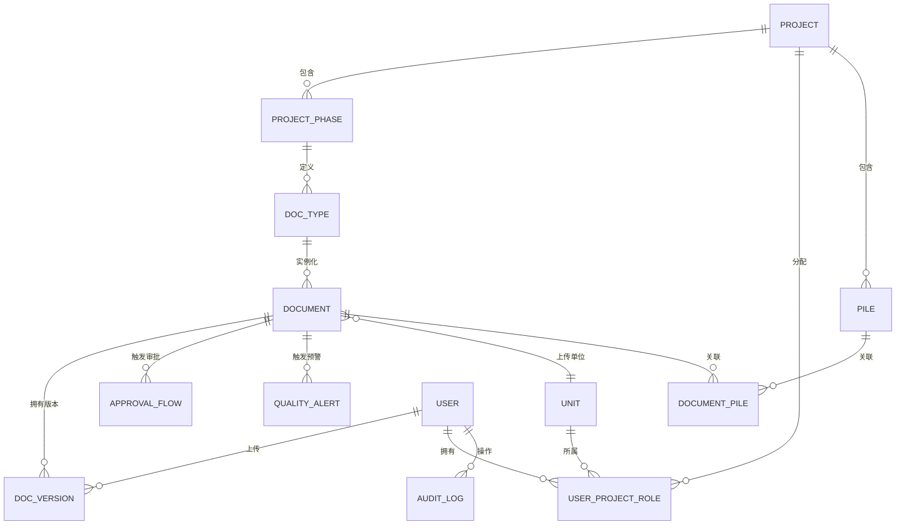

# 数据库设计

## ER 关系图



## 核心表

| 表 | 说明 | 关键字段 |
|---|---|---|
| `projects` | 工程项目 | 项目编号、名称、状态 |
| `project_phases` | 项目七阶段实例 | 阶段名称、顺序、状态 |
| `doc_types` | 某阶段应提交的文档类型 | 责任单位、是否必传、是否审批、文件类型 |
| `documents` | 一类文档下的具体文档实例 | 文档编号、标题、当前版本、状态 |
| `document_versions` | 不可覆盖的版本记录 | 版本号、文件、哈希、上传人、版本说明 |
| `approval_flows` | 文档审批实例 | 审批人、角色、动作、意见、状态 |
| `quality_alerts` | 缺项、超期、数据异常预警 | 等级、类型、内容、处理状态 |
| `units` | 参建单位 | 单位编码、名称、类型、联系人 |
| `users` | 用户 | 账号、姓名、密码哈希、所属单位 |
| `user_project_roles` | 用户与项目的角色关系 | 用户、项目、单位、角色 |
| `piles` | 桩位台账 | 桩号、BIM ID、坐标、桩型、深度、状态 |
| `document_piles` | 文档与桩位多对多关系 | 文档、桩位 |
| `audit_logs` | 操作审计 | 用户、动作、对象、详情、IP、时间 |
| `sessions` | 登录会话 | Token 哈希、CSRF Token、过期时间 |

## 文档生命周期

1. 项目创建七条 `project_phases`。
2. 每条阶段记录下创建多条 `doc_types`，并绑定唯一责任单位。
3. 责任单位上传时，创建 `documents` 与第一条 `document_versions`。
4. 后续更新只能追加 `document_versions`，并更新 `documents.current_version`。
5. 如果 `doc_types.need_approval = 1`，同时创建 `approval_flows` 待审批记录。
6. 所有写操作追加 `audit_logs`，原文和旧版本不删除。
7. 文件可关联多个 `piles`，同一桩位也可关联多份文档。

## 权限判定

上传权限由两个条件共同决定：

```text
用户在该项目中的单位 = 文档类型的 responsible_unit_id
并且
用户在该项目中的角色属于：系统管理员 / 项目经理 / 单位管理员 / 资料员
```

查看权限要求用户至少具备该项目的任意角色。非责任单位可以：

- 查看阶段和文档台账
- 查看版本历史
- 预览和下载文件
- 查看审批与预警

非责任单位不能：

- 创建文档
- 上传新版本
- 修改文档标题或责任单位
- 删除版本或文件

当前原型没有提供修改和删除接口，从数据模型层面保证文档“只增不改”。

## 数据库迁移建议

正式环境建议使用 PostgreSQL，保留业务主键并增加：

- 组织、项目、单位和角色的多租户隔离字段
- 审批会签、审批步骤和电子签章表
- 文件对象存储 Key、缩略图、病毒扫描结果
- 质量指标的时序数据表或时序数据库
- 软删除、数据归档和数据保留策略
- 行级安全策略或统一权限服务
